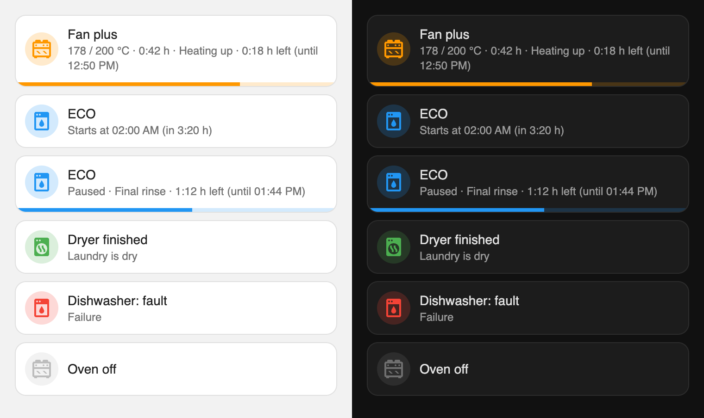
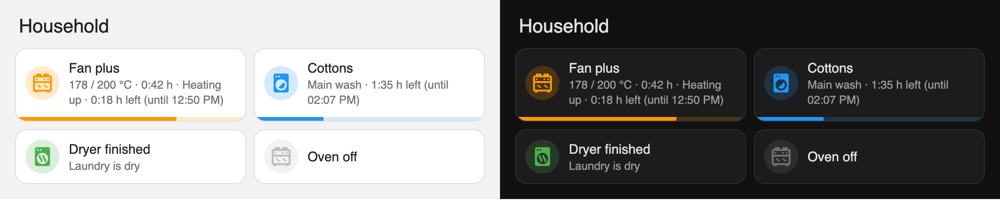
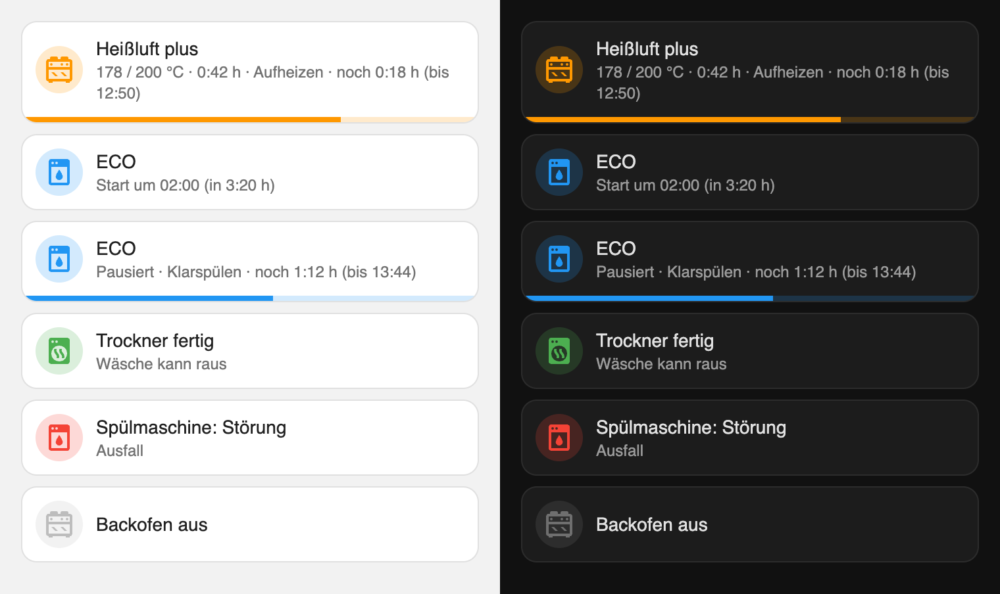
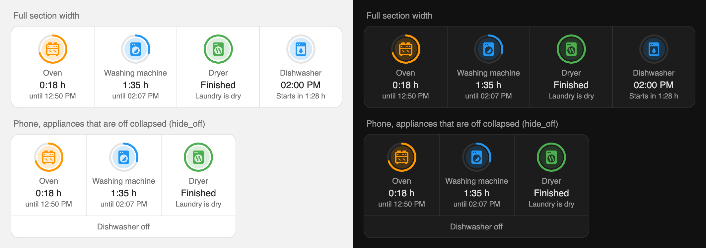
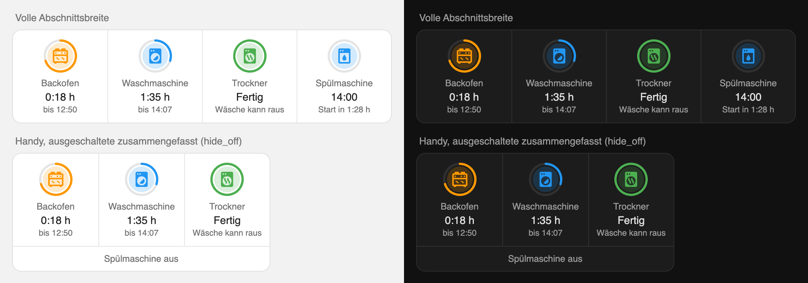

<p align="center">
  <a href="https://my.home-assistant.io/redirect/marketplace_repository/?owner=yannick80&repository=ha-card-for-miele&category=plugin">
    
  </a>
</p>
<p align="center">
  <a href="https://github.com/yannick80/ha-card-for-miele/releases/latest">
    
  </a>
  <a href="https://www.home-assistant.io">
    
  </a>
  <a href="https://github.com/yannick80/ha-card-for-miele/actions/workflows/validate.yml">
    
  </a>
  <a href="https://github.com/yannick80/ha-card-for-miele/releases">
    
  </a>
  <a href="LICENSE">
    
  </a>
</p>

# Card for Miele@LAN

A compact Home Assistant dashboard card for Miele appliances connected through [Miele@LAN](https://github.com/tiehfood/ha-miele-at-lan).
Pick an appliance and the card shows, in one tile, what it is doing right now: programme, phase, temperatures, time left and when it will be done.



<!-- ha-marketplace:exclude-start -->
**Contents:**
[What you get](#what-you-get) ·
[What the card shows](#what-the-card-shows) ·
[Before you start](#before-you-start) ·
[Installation](#installation) ·
[Add the card](#add-the-card) ·
[Options](#options) ·
[Overview card](#overview-card) ·
[Tips](#tips) ·
[Troubleshooting & FAQ](#troubleshooting--faq) ·
[Getting help](#getting-help) ·
[For developers](#for-developers) ·
[Credits](#credits)
<!-- ha-marketplace:exclude-end -->

## What you get

- **One tile per appliance.** Programme in the first line, the details in the second, a progress bar while it runs.
- **Or several appliances in one card.** The [overview card](#overview-card) puts up to four appliances side by side, each with the one value that matters right now.
- **Pick the appliance, not entities.** The card finds the appliance's sensors on its own, whatever language Miele@LAN was set up in and however you renamed them.
- **Ovens, dishwashers, washing machines, dryers, washer-dryers, steam ovens, microwaves and coffee machines.** Parts an appliance does not report are simply left out.
- **Your Home Assistant language.** Programme, phase and drying step come from Miele@LAN's translations. The card's own texts are in English and German.
- **Visual editor.** Search for "Miele@LAN" in the card picker.
- **Fits the sections dashboard.** Half a row wide by default; works in the old masonry view too.
- **No other custom cards needed.** One JavaScript file, no dependencies.
- **Runs on old wall tablets** such as the Shelly Wall Display.

## What the card shows

| State | First line | Second line | Icon |
|---|---|---|---|
| Running | Programme, e.g. **Fan plus** | 178 / 200 °C · 0:42 h · Heating up · 0:18 h left (until 12:50) | appliance colour, progress bar |
| Delayed start | Programme, e.g. **ECO** | Starts at 02:00 (in 3:20 h) | appliance colour |
| Paused | Programme | Paused · Final rinse · 1:12 h left (until 13:44) | appliance colour, progress bar |
| Finished | **Dryer finished** | Laundry is dry | green |
| Fault | **Dishwasher: fault** | the reported status, e.g. Failure | red |
| On, no programme | **Oven on** | selected programme, if any | neutral |
| Off | **Oven off** | – | grey |
| Not reachable | **Oven unavailable** | – | grey |

Temperatures and elapsed time are shown for ovens; core temperature appears when a food probe is in use. Washing machines and dryers show the drying step where it applies.

In a sections dashboard at its default width (6 of 12 columns), the text wraps onto a second line:



<details>
<summary>German interface (Deutsch)</summary>



</details>

## Before you start

- [ ] **Home Assistant 2024.12 or newer.**
- [ ] **[Miele@LAN](https://github.com/tiehfood/ha-miele-at-lan) is installed and your appliance shows up as a device** under **Settings** > **Devices & services** > **Miele@LAN**.
  The card only reads Miele@LAN's sensors. It does not talk to the appliance itself and does not work with the official Miele integration.

<!-- ha-marketplace:exclude-start -->
## Installation

### Home Assistant 2026.11 and newer (Marketplace)

**One click:** select this button, then confirm in your Home Assistant.

[](https://my.home-assistant.io/redirect/marketplace_repository/?owner=yannick80&repository=ha-card-for-miele&category=plugin)

**Or by hand:**

1. In Home Assistant, go to **Settings** > **Marketplace**.
2. In the upper-right corner, select **Add from link**.
3. Under **GitHub link**, enter `https://github.com/yannick80/ha-card-for-miele`. If Home Assistant asks for the type, choose **Dashboard**.
4. Open Card for Miele@LAN and select **Install**.
5. Reload the browser (on phones and tablets: close and reopen the app).

### Home Assistant 2026.10 and older (HACS)

[](https://my.home-assistant.io/redirect/hacs_repository/?owner=yannick80&repository=ha-card-for-miele&category=plugin)

1. Open **HACS** in the sidebar.
2. Select the three dots in the upper-right corner, then **Custom repositories**.
3. Enter `https://github.com/yannick80/ha-card-for-miele`, choose the type **Dashboard**, and select **Add**.
4. Open Card for Miele@LAN and select **Download**.
5. Reload the browser.

### Manual installation

1. Download `miele-card.js` from the [latest release](https://github.com/yannick80/ha-card-for-miele/releases/latest).
2. Copy it to `config/www/miele-card.js` (the `www` folder next to `configuration.yaml`; create it if it does not exist).
3. Go to **Settings** > **Dashboards**, select the three dots, then **Resources**.
   (No **Resources** entry? Turn on **Advanced mode** in your user profile first.)
4. Select **Add resource**, enter `/local/miele-card.js?v=1.1.1`, choose **JavaScript module** and select **Create**.
   Raise the `?v=` number after each update so browsers load the new file.
5. Reload the browser.
<!-- ha-marketplace:exclude-end -->

## Add the card

1. Open a dashboard, select the pencil, then **Add card**.
2. Search for **Miele@LAN** and pick **Card for Miele@LAN**.
3. Pick your appliance under **Device**. That's it; everything else is optional.

In YAML:

```yaml
type: custom:miele-card
device: 0123456789abcdef0123456789abcdef
```

Instead of `device` you can name any entity of the appliance, which is easier when writing YAML by hand:

```yaml
type: custom:miele-card
entity: sensor.kitchen_oven_status
```

## Options

| Option | Default | Description |
|---|---|---|
| `device` | – | Device ID of the Miele@LAN appliance |
| `entity` | – | Alternative to `device`: any sensor of the appliance |
| `name` | by appliance type, e.g. "Oven" | Name used in "… running / finished / off" |
| `icon` | by appliance type | e.g. `mdi:stove` |
| `color` | `orange` for ovens, `blue` otherwise | Icon colour while running; a Home Assistant colour name (`red`, `teal`, …) or any CSS colour |
| `show_elapsed` | `true` for ovens | Show the elapsed time |
| `show_progress` | `true` | Progress bar while running |
| `finished_text` | by appliance type | Second line after the programme has ended |
| `entities` | found automatically | Use a different sensor for a role, see below |

### Using a different sensor

Map the sensor to its role under `entities`. Example: show the programme type instead of the programme:

```yaml
type: custom:miele-card
device: 0123456789abcdef0123456789abcdef
entities:
  program_id: sensor.kitchen_oven_program_type
```

Roles: `status`, `program_id`, `program_type`, `program_phase`, `remaining_minutes`, `elapsed_minutes`, `start_in_minutes`, `finish_time`, `progress`, `cavity_temperature`, `target_temperature`, `core_temperature`, `core_target_temperature`, `drying_step`.

### Full example

```yaml
type: custom:miele-card
device: 0123456789abcdef0123456789abcdef
name: Laundry
icon: mdi:washing-machine
color: teal
show_progress: true
finished_text: Time to hang it up
```

## Overview card

For a summary dashboard: several appliances side by side in one card, each showing only the most important value. Tap an appliance to open its status with all details.



| State | Large value | Below | Ring around the icon |
|---|---|---|---|
| Running | Time left, e.g. **0:18 h** | until 12:50 | progress in the appliance colour |
| Paused | Time left | Paused | progress |
| Delayed start | Start time, e.g. **14:00** | Starts in 1:28 h | – |
| Finished | **Finished** | Laundry is dry | full, green |
| Fault | **Fault** | the reported status | – (red icon) |
| On, no programme | **On** | selected programme, if any | – |
| Off / not reachable | **Off** / **offline** | – | – (grey icon) |

Add it with **Add card** > **Overview card for Miele@LAN** and pick the appliances. In YAML:

```yaml
type: custom:miele-overview-card
devices:
  - 0123456789abcdef0123456789abcdef
  - fedcba9876543210fedcba9876543210
  - sensor.dishwasher_status          # any sensor of the appliance works too
  - device: 00112233445566778899aabbccddeeff
    name: Wash                        # short names fit better on phones
```

| Option | Default | Description |
|---|---|---|
| `devices` | – | List of appliances: a device ID, any sensor of the appliance, or a mapping with options |
| `columns` | up to 4 | Appliances per row; more appliances wrap onto the next row |
| `hide_off` | `false` | Leave out appliances that are off or unavailable and list them in one line instead ("Dishwasher off", or "All appliances off") |

Options per appliance (in the mapping form): `device` or `entity`, `name`, `icon`, `color`, `show_progress`, `finished_text` and `entities`, as for the [single card](#options). The visual editor sets the appliances and the card options; per-appliance options are set in YAML and kept when you change the list in the editor.

The card is meant for the full section width (12 columns). On a phone, four appliances get about 85 px each: long names such as "Washing machine" are shortened with "…", so give them a short `name`.

<details>
<summary>German interface (Deutsch)</summary>



</details>

## Tips

- **Hide the card while the appliance is off.** In a sections dashboard, open the card's **Visibility** tab and add a condition on the state of the appliance's **Status** sensor. In other dashboards, wrap the card in a `conditional` card.
- **Tap the card** to open the appliance's **Status** sensor with its history.
- **Several appliances** look best two per row in a sections dashboard (the default width), or together in the [overview card](#overview-card).
- **Notifications** ("laundry is done") are a job for an automation on the **Status** sensor, not for the card. See [Miele@LAN's notes on automations](https://github.com/tiehfood/ha-miele-at-lan#notifications-and-automations).

## Troubleshooting & FAQ

### "Custom element doesn't exist: miele-card"

The browser has not loaded the card. Reload the page, and on phones and tablets close and reopen the Home Assistant app.
After a manual install, check the resource under **Settings** > **Dashboards** > **Resources**: `/local/miele-card.js` as **JavaScript module**.

### "No Miele@LAN device selected" / "Device not found"

Pick the appliance in the card editor. "Device not found" means the device ID in the YAML no longer exists, for example after Miele@LAN was removed and set up again. Pick the appliance again.

### "No status sensor found"

The card found the device but not its **Status** sensor. Check on the device page that the Status sensor exists and is enabled, or map it yourself under `entities: status:`.

### A detail is missing (temperature, time left, phase …)

The card only shows what Miele@LAN reports. Many sensors stay "Unknown" until a programme runs, and some appliances never report certain values. Check the matching sensor on the device page: if it is "Unknown" there, the card leaves it out.

### The card still shows the old version after an update

Reload the browser with the cache cleared. The browser console (F12) shows the loaded version as `miele-card 1.1.1`.

## Getting help

Open an [issue](https://github.com/yannick80/ha-card-for-miele/issues/new/choose). Please include:

- the card version (shown in the browser console as `miele-card x.y.z`),
- your Home Assistant and Miele@LAN versions,
- the appliance type and model,
- your card YAML and, for display problems, a screenshot.

Problems with the appliance's sensors themselves (wrong values, missing entities, setup) belong to [Miele@LAN](https://github.com/tiehfood/ha-miele-at-lan/issues).

## For developers

The card is a single plain JavaScript file, `dist/miele-card.js`, without build step or dependencies. Edit it, copy it to `config/www/` and reload the browser with the cache disabled.

Tests need only Node.js 22:

```sh
node --test tests/*.mjs
```

The preview images in `docs/` are rendered from the real card with a mocked Home Assistant: `sh docs/render-previews.sh` (needs Google Chrome).

See [AGENTS.md](AGENTS.md) for the rules the card follows (old WebViews, error handling, entity lookup) and [CHANGELOG.md](CHANGELOG.md) for what changed.

**Translations** are welcome: add a language to `STRINGS` in `dist/miele-card.js` and open a pull request.

**Releasing:** bump `VERSION` in `dist/miele-card.js`, move the CHANGELOG entry to the new version, then publish a GitHub release with the tag `vX.Y.Z`. The release workflow checks the version and attaches the file.

## Credits

This card would not exist without **[Miele@LAN](https://github.com/tiehfood/ha-miele-at-lan)** by [tiehfood](https://github.com/tiehfood).
Miele@LAN does the hard part: it talks to the appliances directly over the home network and turns what they report into Home Assistant sensors, with translated programmes and phases. This card only puts those sensors on a dashboard.
Thank you for building and maintaining it! If the card is useful to you, please give Miele@LAN a ⭐ too.

The icons are from [Material Design Icons](https://pictogrammers.com/library/mdi/), which ship with Home Assistant.

## Disclaimer

This project is independent and not affiliated with, endorsed by, or supported by Miele & Cie. KG. **Miele®** and **Miele@home®** are registered trademarks of Miele & Cie. KG; the name is used only to say which appliances the card is for. The repository contains no Miele logos or other Miele artwork.

## License

[MIT](LICENSE)
